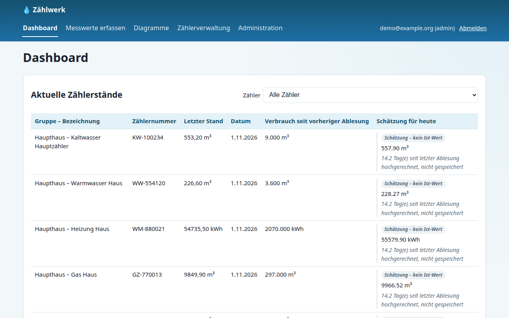
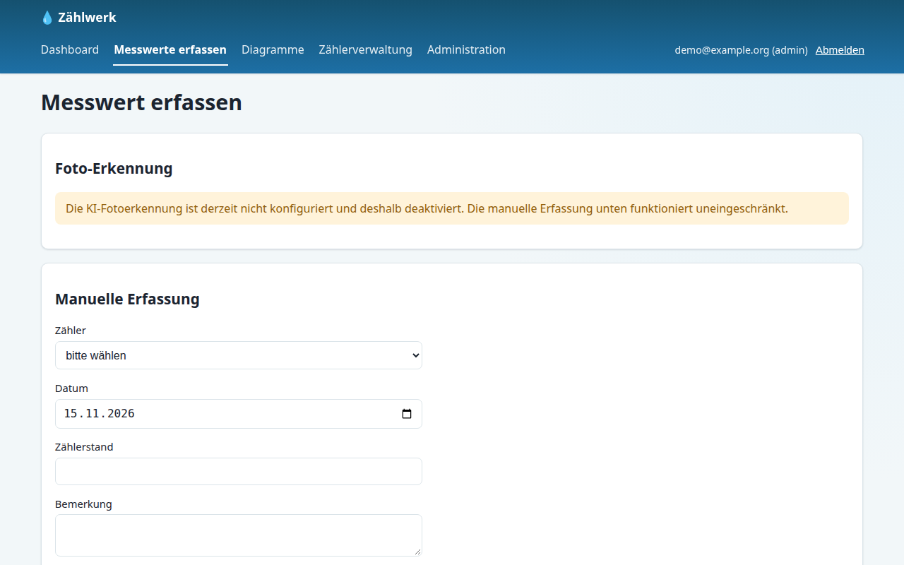
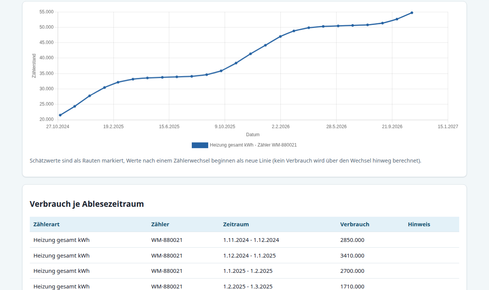
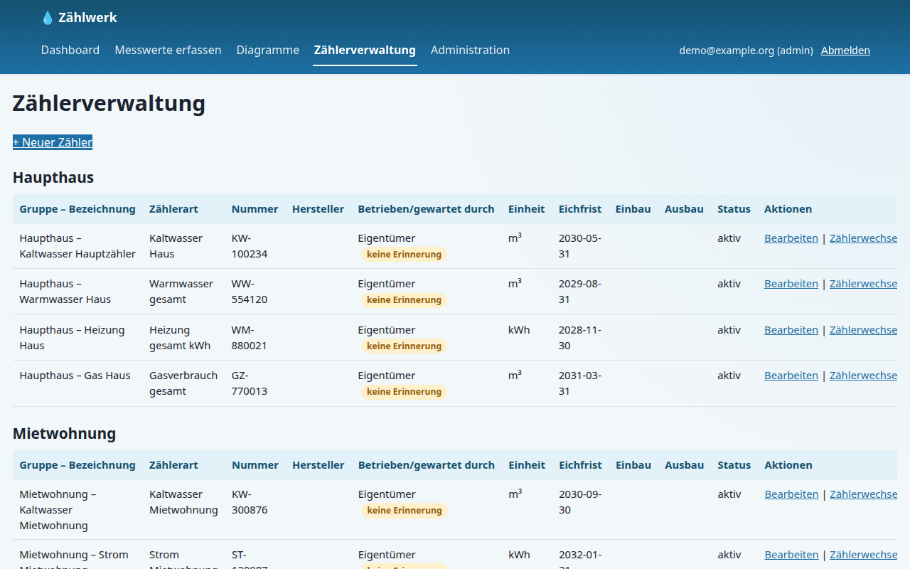
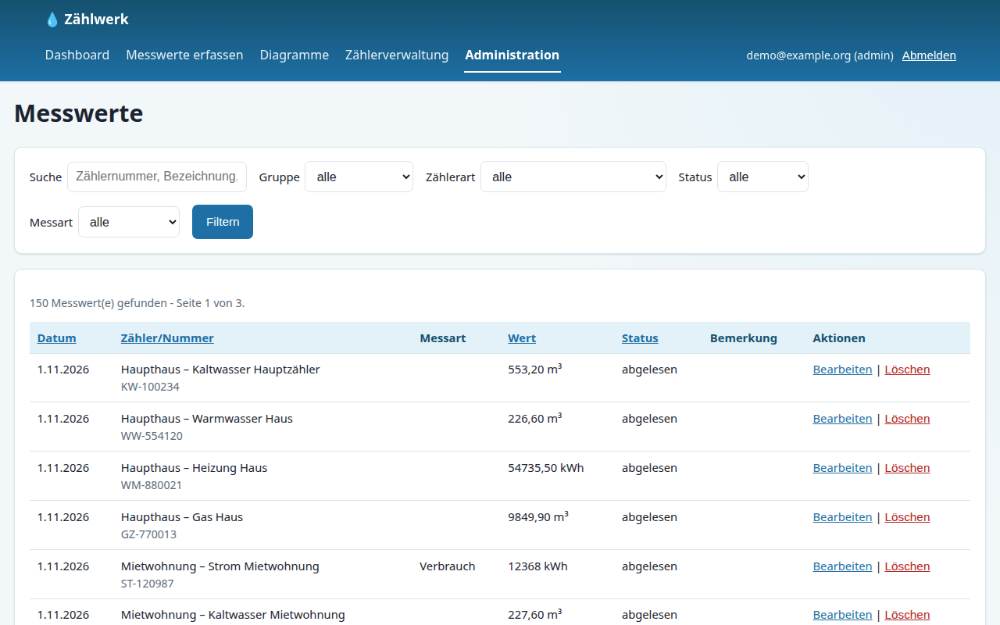
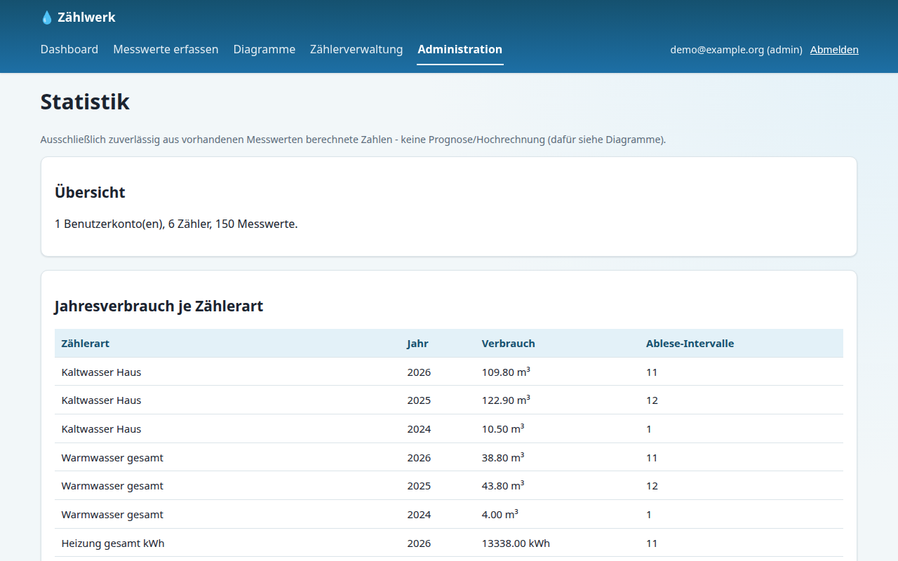

# Zaehlerstandsermittlung ("Zählwerk")

Web-App zur Erfassung und Auswertung der Zaehlerstaende eines Hauses mit Mietwohnung
(Kaltwasser, Warmwasser, Heizung, Gas, Strom - jeweils Haus gesamt und Mietwohnung).




**Produktname:** Die Anwendung zeigt sich seit dem Auftrag "Messwerte-Tabelle,
Zählerverwaltung, Import/Export, Rechtliches" unter dem vorläufigen,
konfigurierbaren Anzeigenamen **„Zählwerk“** (Umgebungsvariable `PRODUCT_NAME`,
Standard „Zählwerk“) - rein kosmetisch (Titel, Kopfzeile, E-Mail-Betreffs). Der
technische AppFactory-Projekt-Slug `zaehlerstandsermittlung-1` (Ordner,
Compose-Service, Datenbankname) bleibt unverändert. Es wurde keine Marken-
oder Namensverfügbarkeit geprüft. Strukturelle Vorbereitung für eine spätere
Veröffentlichung als Unraid Community Applications Docker-App: siehe
`docs/UNRAID.md` (nicht veröffentlicht, nur vorbereitet).

## Funktionen

- Dashboard mit aktuellen Zählerständen (eindeutig als "Gruppe – Bezeichnung"
  angezeigt, z. B. "Mietwohnung – Kaltwasser"), letztem Ablesedatum, Verbrauch
  seit der vorherigen Ablesung und anstehenden/abgelaufenen Eichfristen; nach
  Ablesedatum sortiert (nicht nach Erfassungszeitpunkt).
- Admin-verwaltete Zählergruppen (z. B. "Haupthaus", "Mietwohnung", unter
  Administration -> Zählergruppen) - bereits verwendete Gruppen werden nicht
  gelöscht, nur deaktiviert. Jeder Zähler wird genau einer Gruppe zugeordnet und
  kann zusätzlich eine frei eingebbare Anzeige-Bezeichnung erhalten.
- Rollen/Berechtigungen: Benutzer (Rolle "Benutzer") dürfen ausschließlich
  Messwerte erfassen - und das nur für die Zählergruppen, die ein Admin ihnen
  unter Benutzerverwaltung freigibt (ein Zähler ohne Gruppe ist für Benutzer
  nicht erfassbar). Zähler-, Gruppen- und Zählerartenverwaltung, Diagramme-
  Prognose-Details sowie Import/Export/Administration sind ausschließlich
  Admins vorbehalten - serverseitig in jeder betroffenen Route durchgesetzt,
  nicht nur in der Oberfläche.
- **Admin-Messwerttabelle** (Administration -> Messwerte): übersichtliche,
  Excel-ähnliche Ansicht **aller** Messwerte (Datum, Zähler/Nummer, Messart,
  Wert, Status, Bemerkung) mit Suche (Zählernummer/Bezeichnung/Bemerkung),
  Filtern (Gruppe, Zählerart, Status, Messart), Sortieren je Spalte und
  Seitenweiser Anzeige (50 je Seite). Nur Admins dürfen hier jeden Eintrag
  direkt bearbeiten (alle Felder inkl. Zähler-Zuordnung und Messart) oder mit
  Bestätigung löschen - beides serverseitig geprüft und mit altem/neuem Zustand
  im Audit-Protokoll vermerkt. Die bestehende, auf die letzten 50 Einträge
  begrenzte Liste unter "Messwerte erfassen" bleibt unverändert (dort gilt für
  Benutzer weiterhin nur der Korrektur-Workflow, siehe unten).
- Manuelle Messwerterfassung (immer verfuegbar) mit optionaler Foto-Erkennung durch
  einen konfigurierbaren KI-Anbieter (OpenAI-kompatibel, Anthropic-API oder Ollama,
  inkl. direkter Kameraaufnahme auf dem Smartphone); KI-Vorschlaege muessen vor dem
  Speichern immer bestaetigt werden. Die KI-Verfügbarkeit wird im Hintergrund
  geprüft (kein Foto-Upload/keine Bildanalyse beim Laden der Seite) und erst nach
  erfolgreicher Prüfung mit einem grünen, pulsierenden Indikator als verfügbar
  angezeigt; schlägt die Prüfung fehl, erscheint ein klarer Hinweis.
- Zählerverwaltung (Anlegen/Ändern/Löschen ausschließlich durch Admins,
  erreichbar sowohl über die Hauptnavigation "Zählerverwaltung" als auch über
  Administration -> Zähler) inkl. Feld "betrieben/gewartet durch"
  (Eigentuemer/Energieversorger, steuert die Eichfrist-Erinnerung je Zaehler)
  und Zaehlerwechsel (alter Zaehler wird geschlossen, neuer Zaehler beginnt
  eine eigene Messreihe - Historie bleibt unveraendert, Verbrauch wird nie ueber
  den Wechsel hinweg berechnet; Gruppe, Bezeichnung und Betreiber-Einstellungen
  werden dabei vom alten Zähler übernommen). Die Liste gruppiert aktive Zähler
  nach ihrer Zählergruppe; nicht mehr verbaute/ausgebaute Zähler (z. B. nach
  einem Zählerwechsel) stehen separat und deutlich beschriftet am Ende - ihr
  Status wird dabei nicht automatisch umgedeutet.
- Admin-verwaltete Zaehlerarten (Name, Einheit nur m³ oder kWh, Vorgaben "Vom
  Versorger betrieben" und "Eichdaten anzeigen") unter Administration ->
  Zaehlerarten; beide Vorgaben sind je einzelnem Zaehler ueberschreibbar, bereits
  verwendete Zaehlerarten werden statt geloescht nur deaktiviert. Eine Zählerart
  kann bei der Neuanlage als **Wärmemengenzähler** markiert werden (nicht mehr
  änderbar): Zähler dieser Art fragen bei jeder Erfassung gemeinsam kWh und m³
  ab (beide Pflicht, Einheit automatisch kWh).
- Stromzaehler ("Strom Haus" u. a.) erfassen Verbrauch (OBIS 1.8.0) und optional
  Einspeisung (OBIS 2.8.0) zum selben Ablesedatum als getrennte Messreihen -
  getrennt angezeigt und ausgewertet (Dashboard, Messwerte, Diagramme, Statistik).
  Wärmemengenzähler erfassen analog kWh und m³ gemeinsam (beide Pflicht statt
  nur die Einspeisung optional) und werden ebenso getrennt ausgewertet.
- Eigener Statistik-Bereich (Administration -> Statistik) mit Jahresverbrauch je
  Zaehlerart aus bereits gespeicherten Messwerten (keine Prognose).
- Diagramme je Zaehlerart/Zeitraum mit Vorjahresvergleich, Kennzeichnung von
  Schaetzwerten/Luecken/Zaehlerwechseln, sowie eine unverbindliche statistische
  Prognose ohne KI-Pflicht (bei Heizung/Gas saisonal, sonst Durchschnittsverbrauch
  der Historie) und ein optional anzeigbarer, taeglich neu berechneter
  voraussichtlicher aktueller Zaehlerstand auf dem Dashboard - beides nur Anzeige,
  nirgends gespeichert oder exportiert.
- Benutzerverwaltung (Admin/Benutzer), SMTP-Einstellungen mit Testversand und
  Eichfrist-Benachrichtigung per Mail, Admin-Audit-Protokoll fuer Messwerterfassungen
  und Zaehleraenderungen.
- Import/Export in JSON, CSV und Excel (.xlsx), ausschliesslich fuer Admins
  (UI, Routen und API), mit Vorschau/Fehlerbericht vor dem Import; bestehende
  Messwerte werden nie stillschweigend ueberschrieben, wiederholter Import
  derselben Datei erzeugt keine doppelten Messwerte (Dublettenprüfung je
  Zähler/Zeitpunkt/Messart). Die Importvorlage hat keine Uhrzeit-Spalte und
  eine Spalte "Messart" für Stromzähler (verbrauch/einspeisung) bzw.
  Wärmemengenzähler (kwh/m3, je eigene Zeile zum selben Datum) - siehe
  Abschnitt "Import/Export-Format". Ein **vollständiger JSON-Export** (Admin ->
  Export -> JSON) legt dabei auch fehlende Zähler-Stammdaten (Zählergruppen,
  Zählerarten, Zähler) automatisch an, bevor die Messwerte zugeordnet werden -
  der Import funktioniert damit auch auf einem frischen oder vollständig
  zurückgesetzten System.
- Bestehende Messwerte können **ausschließlich von Admins direkt bearbeitet**
  werden (Wert/Datum, serverseitig autorisiert und im Audit-Protokoll mit
  altem/neuem Wert protokolliert). Normale Benutzer erstellen stattdessen einen
  **Korrektur-Vorschlag** zu einem bestehenden Messwert (eigene Begründung
  Pflicht); dieser ändert den Messwert erst nach Genehmigung durch einen Admin
  unter Administration -> Korrekturen (Admin kann auch ablehnen, mit optionalem
  Kommentar). Beides ist über den Link "Bearbeiten"/"Korrigieren" in der Liste
  "Zuletzt erfasste Messwerte" erreichbar und serverseitig auf die
  Zählergruppen-Berechtigung des jeweiligen Zählers beschränkt.
- Admin-verfügbare, gezielte Aktion zum **Löschen aller Messwerte** (nicht der
  gesamten Datenbank): Zähler, Zählerarten, Zählergruppen, Benutzerkonten,
  Einstellungen und Audit-Protokoll bleiben erhalten; nur Fotos, die
  ausschließlich zu gelöschten Messwerten gehören, werden mitgelöscht. Klare
  Warnung und exakte Textbestätigung vor der Ausführung, transaktional und
  protokolliert (Administration -> Messwerte löschen).
- Administratives Zuruecksetzen **der gesamten Datenbank** (Zähler **und**
  Messwerte) nur nach erzwungenem Export + Download + ausdruecklicher
  Textbestaetigung - für das Löschen nur der Messwerte siehe oben.
- **Separater Zähler-Stammdaten-Import/-Export** (Administration -> Import &
  Export -> "Zähler-Stammdaten exportieren"/"-importieren"), **unabhängig** vom
  Messwerte-Import/-Export: exportiert/importiert ausschließlich Zählergruppen,
  Zählerarten und Zähler - nie Messwerte, Benutzerkonten, Fotos oder
  Einstellungen. Funktioniert auch mit einer Datei ohne Messwerte (leeres
  `readings`-Array); das Dateiformat entspricht den Stammdaten-Feldern des
  vollständigen JSON-Exports und ist mit diesem gegenseitig kompatibel. Vor dem
  Übernehmen zeigt eine Vorschau je Gruppe/Zählerart/Zähler, ob sie neu
  angelegt würden, bereits vorhanden sind (werden **nie überschrieben**) oder
  einen Konflikt darstellen (z. B. eine im Export nicht auflösbare Zählerart -
  wird übersprungen und nach dem Import namentlich gemeldet). Reihenfolge
  Gruppen -> Zählerarten -> Zähler, transaktional. Der bestehende
  Messwerte-Import erkennt eine reine Zähler-Stammdatendatei (keine Messwerte)
  jetzt ausdrücklich und verweist auf diese separate Funktion, statt sie als
  (leeren) Messwertimport zu verarbeiten.
- E-Mail-Benachrichtigung bei **jeder neu erfassten** Messwerterfassung
  (Menüpunkt "Messwerte erfassen") an eine unter Administration -> SMTP-
  Einstellungen separat konfigurierbare Empfängerliste (eigene Liste,
  unabhängig von der Eichfrist-Warnung) - eine E-Mail je Erfassungsvorgang,
  auch wenn dabei mehrere Teilwerte (z. B. Verbrauch + Einspeisung) gespeichert
  werden. Korrekturen, Admin-Bearbeitungen, Löschungen und Importe lösen
  bewusst **keine** E-Mail aus. Ein Mailfehler verhindert nie das Speichern des
  Messwerts (Versand läuft asynchron nach dem Speichern, Fehler werden nur
  knapp im Server-Log vermerkt).
- Öffentlich erreichbare Seite **„Rechtliches“** (`/rechtliches`, ohne
  Anmeldung, verlinkt in der Fußzeile jeder Seite) mit editierbaren
  Textvorlagen für Impressum und Datenschutzhinweise (Administration ->
  Rechtliches) - unausgefüllte Platzhalter ("Max Mustermann" u. ä.), keine
  Rechtsberatung, keine Prüfung durch die Anwendung. Zusätzlich ein knapper,
  nicht blockierender **Cookie-Hinweis** (keine Einwilligungsmaske): die
  Anwendung hat aktuell keine einwilligungspflichtigen optionalen Cookies,
  verarbeitet aber IP-Adressen (Ratenbegrenzung Login, externe Lese-API) und
  ein technisch notwendiges Session-Cookie - der Hinweis informiert darüber
  und lässt sich einfach wegklicken (Sichtbestätigung per `localStorage`, kein
  zusätzliches Cookie).
- Administration ist jetzt in Gruppen "Zähler", "Messwerte", "Import &
  Export" (inkl. der bisherigen Export-/Import-Funktionen, die vorher über
  eigene Hauptnavigationspunkte erreichbar waren), "Backup", "System" und
  "Rechtliches" gegliedert.
- Versionierte, ausschliesslich lesende API (`/api/v1`) fuer ein externes
  Nebenkostenabrechnungsprogramm, standardmaessig deaktiviert, mit admin-
  verwaltetem Schluessel (siehe Abschnitt "Externe Lese-API").
- Admin-gefuehrter Datenbankwechsel SQLite <-> MariaDB mit Verbindungstest,
  Pflicht-Backup, Migration und Verifikation vor der Uebernahme (siehe Abschnitt
  "Datenbankwechsel").
- Vollstaendiges, technisches Vollbackup (Admin -> Vollbackup / Wiederherstellung)
  fuer eine komplette Wiederherstellung auf einem neu aufgesetzten Server: alle
  Datenbanktabellen (inkl. Benutzerkonten, Einstellungen, Audit-Protokoll),
  hochgeladene Fotos und die Original-Excel-Vorlage als vertrauliche ZIP-Datei;
  Wiederherstellung nur fuer Admins, mit Vorschau, erzwungener Sicherheitskopie
  des aktuellen Standes und ausdruecklicher Textbestaetigung (siehe Abschnitt
  "Vollbackup / Wiederherstellung").

## Screenshots

| Ansicht | Beschreibung |
|---|---|
|  | Aktuelle Zählerstände, Verbrauch seit der letzten Ablesung und Schätzung für heute. |
|  | Manuelle Erfassung eines Messwerts. |
|  | Verlauf je Zählerart mit Vorjahresvergleich. |
|  | Zähler mit Gruppe, Nummer und Eichfrist verwalten (Admin). |
|  | Admin-Messwerttabelle zum Prüfen und Bearbeiten. |
|  | Jahresverbrauch je Zählerart. |

Die Screenshots zeigen eine eigens angelegte Demo-Instanz mit erfundenen Beispieldaten.

## Bedienung

1. Anmelden (das Erstkonto steht im Abschnitt „Ersteinrichtung“).
2. Admin: unter **Zählerverwaltung** die realen Zähler mit Zählernummer, Zählerart und Gruppe anlegen.
3. **Messwerte erfassen**: Zähler wählen, Stand und Datum eintragen (Benutzer nur für freigegebene Gruppen).
4. Das **Dashboard** zeigt die aktuellen Stände, **Diagramme** den Verlauf, **Administration → Statistik** den Jahresverbrauch.
5. Import/Export, Benutzer, Zählergruppen, SMTP und Vollbackup findest du unter **Administration**.

## Fehlersuche

- Kein Zugang: `docker compose logs zaehlerstandsermittlung-1_app` zeigt beim ersten Start das einmalig erzeugte Admin-Passwort.
- Benutzer kann nichts erfassen: unter Administration → Benutzer die Gruppenrechte vergeben.
- Port belegt: Port 3008 in `docker-compose.yml` und `.env` anpassen.
- Daten gesichert? Siehe „Backup / Restore“ weiter unten bzw. Admin → Vollbackup.

## Start (gemaess AppFactory-Konventionen)

Die AppFactory startet den Container automatisch (`docker compose up -d`, bei
Aenderungen zusaetzlich `restart`) und prueft den Port. Manuell (z. B. lokal):

```
docker compose up -d
```

Die App laeuft dann auf Port 3008 (`0.0.0.0:3008` im Container, in `docker-compose.yml`
als `"3008:3008"` veroeffentlicht).

## Ersteinrichtung

1. **Datenbank waehlen** (`.env`, `DB_DRIVER`):
   - `sqlite` (Standard): keine externe Datenbank noetig, Datei liegt persistent
     unter `data/db.sqlite` im Docker-Volume.
   - `mariadb`: externe MariaDB unter `DB_HOST`/`DB_PORT` (Vorlage: `<db-host>:3306`),
     Datenbankname `zaehlerstandsermittlung-1_db`. **`DB_PASSWORD` muss von einem
     Menschen in die `.env` eingetragen werden** (bleibt in der Vorlage leer).
2. **Admin-Erstkonto:** Beim allerersten Start ohne vorhandene Benutzer wird ein
   Admin-Konto angelegt (`ADMIN_INITIAL_EMAIL`, Standard `admin@local`). Ist
   `ADMIN_INITIAL_PASSWORD` in der `.env` leer, erzeugt die App ein zufaelliges
   Passwort und gibt es **einmalig** in den Container-Logs aus
   (`docker compose logs zaehlerstandsermittlung-1_app`). Danach sofort in der
   Benutzerverwaltung aendern.
3. **SESSION_SECRET / ENCRYPTION_KEY:** werden automatisch erzeugt und persistent
   unter `data/secrets.json` abgelegt, sofern nicht per `.env` gesetzt. Kein
   manueller Schritt noetig.
4. **SMTP** (Admin -> SMTP-Einstellungen): Server, Port, Verschluesselung,
   Zugangsdaten, Absender eintragen, Testversand nutzen, danach Eichfrist-
   Benachrichtigung (Empfaengerliste, Vorlaufzeit) und optional die
   Benachrichtigung bei neuen Messwerten (eigene Empfaengerliste) aktivieren.
5. **KI-Fotoerkennung** (Admin -> KI-Einstellungen, optional): Anbieter (OpenAI-
   kompatibler Endpunkt, Anthropic-API oder Ollama), Endpunkt-URL, Modell und API-Key
   eintragen (bei Anthropic ist der API-Key erforderlich). Ohne vollstaendige
   Konfiguration oder bei Nichterreichbarkeit bleibt die manuelle Erfassung
   uneingeschraenkt nutzbar, die Fotoerkennung wird dann klar als nicht verfuegbar
   angezeigt.
6. **Zählergruppen** (Admin -> Zählergruppen): mindestens die Standardgruppen
   "Haupthaus" und "Mietwohnung" sind bereits angelegt, weitere Gruppen können
   ergänzt werden.
7. **Zähler anlegen** (Zählerverwaltung, nur Admin): für jeden realen Zähler
   einen Eintrag mit Zählernummer, Zählerart, Gruppe, optionaler Anzeige-
   Bezeichnung, Eichdaten usw. anlegen, bevor Messwerte oder ein Import dafür
   erfasst werden können.
8. **Gruppenrechte je Benutzer** (Admin -> Benutzerverwaltung): für jedes
   Benutzerkonto (Rolle "Benutzer") festlegen, für welche Zählergruppen es
   Messwerte erfassen darf - ohne Freigabe kann der Benutzer keine Messwerte
   eintragen. Administratoren sind davon unabhängig immer für alle Gruppen
   berechtigt.

## Import/Export-Format

Die Messwerte-Spalten (Import-Vorschau, Import-Vorlage, CSV-/Excel-Export) sind:
`Zählernummer, Zählerart, Datum, Wert, Einheit, Messart, Status, Bemerkung`
(keine Uhrzeit-Spalte - die Ableseuhrzeit wird auch bei der manuellen Erfassung
nicht abgefragt). Die Spalte **Messart** unterscheidet die beiden gemeinsam
erfassten Teilwerte:

- **Stromzähler:** `verbrauch` (OBIS 1.8.0, Standard, wenn leer) oder
  `einspeisung` (OBIS 2.8.0, optional) - je eine eigene Zeile zum selben
  Zähler und Ablesedatum.
- **Wärmemengenzähler:** `kwh` oder `m3` - beide sind Pflicht und müssen als
  zwei eigene Zeilen zum selben Zähler und Ablesedatum vorhanden sein.
- Bei allen anderen Zählerarten bleibt die Spalte leer.

Eine Muster-Datei mit je einem Beispiel für normale Zähler, Stromzähler und
Wärmemengenzähler steht unter Admin -> Import -> "Muster-Datei herunterladen"
bereit.

**CSV/Excel (nur Messwerte):** Der passende Zähler (per Zählernummer) muss
bereits in der Zählerverwaltung angelegt sein - fehlende oder nicht eindeutig
zuordenbare Zähler werden in der Vorschau klar als Fehler angezeigt, nichts
wird stillschweigend falsch zugeordnet.

**JSON - vollständiger Export (alle Daten):** Enthält zusätzlich die
Zähler-Stammdaten (Zählergruppen, Zählerarten, Zähler). Fehlende Stammdaten
(gleicher Name/Schlüssel/Zählernummer existiert noch nicht) werden beim
Übernehmen automatisch angelegt, bevor die Messwerte zugeordnet werden - die
Vorschau zeigt vorab an, was neu angelegt würde. Bereits vorhandene Einträge
werden dabei nie verändert oder überschrieben. **Nicht** Teil dieses Imports:
Benutzerkonten, Fotos, Einstellungen, Audit-Protokoll (dafür: Admin ->
Vollbackup / Wiederherstellung) und Zählerwechsel-Verknüpfungen
(`ersetzt_meter_id` - müsste danach manuell in der Zählerverwaltung
nachgetragen werden).

**Zahlen/Datum beim Import:** Der Wert akzeptiert Dezimalkomma (z. B. "123,45")
und weiterhin einen einzelnen Dezimalpunkt; mehrdeutige Eingaben (z. B.
mehrere Kommas oder eine unklare Mischung aus Punkt und Komma) werden mit
verständlicher Meldung abgelehnt. Das Datum akzeptiert sowohl `TT.MM.JJJJ` als
auch das bisherige `JJJJ-MM-TT`; inhaltlich ungültige Daten (z. B. 31.02.)
werden abgelehnt statt stillschweigend umgedeutet.

## Original-Excel-Datei spaeter einbringen

Die Originaldatei "Zaehlerstaende.xlsx" liegt bei der Erstellung dieser App noch
nicht vor. Sobald sie ueber die AppFactory bzw. den dafuer vorgesehenen Projekt-
/Dateibereich ins Projekt gelegt wurde:

1. Datei nach `data/vorlagen/Zaehlerstaende-Original.xlsx` legen (persistenter
   Ordner, wird nicht durch `npm install`/Neustarts ueberschrieben).
2. Der Excel-Export (`/export/xlsx`) nutzt die Originaldatei danach automatisch
   als Vorlage (eigenes Blatt "Messwerte_Export" wird angehaengt bzw. ersetzt,
   Layout/Formatierung der uebrigen Blaetter bleiben erhalten).
3. Fuer den **Import** realer Altdaten aus dieser Datei: ueber Admin -> Import
   hochladen, die Vorschau mit Fehler-/Warnbericht pruefen (unbekannte
   Zaehlernummern muessen vorher in der Zaehlerverwaltung angelegt werden) und
   erst danach uebernehmen. Es werden nie bestehende Messwerte stillschweigend
   ueberschrieben (Dubletten gleichen Zaehlers/Zeitpunkts werden uebersprungen).

Die im urspruenglichen Auftrag enthaltene Tabellenabschrift ist nur fachlicher
Kontext gewesen und wurde nicht als Datenquelle verwendet.

## Externe Lese-API

Fuer ein spaeter separat zu beauftragendes externes Nebenkostenabrechnungsprogramm
steht unter `/api/v1` eine **ausschliesslich lesende** Schnittstelle bereit.
Standardmaessig deaktiviert; Verwaltung unter Admin -> Externe Lese-API.

- **Aktivierung/Schluessel:** Ein Admin erzeugt dort einen zufaelligen Schluessel
  (wird nur dieses eine Mal im Klartext angezeigt, danach nur noch als SHA-256-
  Hash gespeichert), aktiviert/deaktiviert den Zugriff separat und kann den
  Schluessel jederzeit widerrufen (macht ihn sofort ungueltig).
- **Authentifizierung:** HTTP-Header `Authorization: Bearer <Schluessel>`.
  Niemals als URL-Parameter uebertragen. Vergleich erfolgt zeitkonstant.
- **HTTPS-Pflicht:** Standardmaessig verlangt die API eine Verbindung ueber
  HTTPS (`req.secure`, inkl. `X-Forwarded-Proto` hinter einem Reverse Proxy -
  siehe Abschnitt "Betrieb hinter Apache/Nginx"). Im reinen AppFactory-Testbetrieb
  ohne TLS kann dies ueber `API_REQUIRE_HTTPS=false` in der `.env` voruebergehend
  abgeschaltet werden - **vor echtem externen Zugriff wieder entfernen/auf
  `true` setzen**.
- **Rate-Limit/Sperre:** Maximal 120 Anfragen/Minute und IP (HTTP 429 bei
  Ueberschreitung); zusaetzlich wird eine IP nach 10 fehlgeschlagenen
  Authentifizierungsversuchen innerhalb von 15 Minuten voruebergehend gesperrt.
- **Audit:** Jeder erfolgreiche und fehlgeschlagene Zugriff wird knapp im
  Audit-Protokoll vermerkt (IP, Pfad bzw. Fehlgrund) - der Schluessel selbst
  erscheint dort nie.
- **Pagination:** Query-Parameter `seite` (Standard 1) und `pro_seite`
  (Standard 100, maximal 500).
- **Daten:** Es werden ausschliesslich tatsaechlich gespeicherte Werte
  geliefert. Die unverbindliche, nur angezeigte Prognose (Dashboard/Diagramme)
  ist **nicht** Teil dieser API.

### Endpunkte

`GET /api/v1/zaehler` - aktive und historische Zaehler inkl. Zaehlerart,
Wechselbeziehung (`ersetzt_zaehler_id`/`ersetzt_durch_zaehler_id`) und Metadaten:

```
curl -H "Authorization: Bearer zs_..." \
  "https://<host>/api/v1/zaehler?seite=1&pro_seite=100"
```
```json
{
  "daten": [
    {
      "id": 2, "zaehlernummer": "TEST-002", "aktiv": true,
      "zaehlerart": { "id": 1, "schluessel": "kaltwasser_haus", "bezeichnung": "Kaltwasser Haus" },
      "einheit": "m³", "hersteller": null, "messbetreiber": null,
      "typ_bezeichnung": null, "betreiber_typ": "eigentuemer",
      "eich_datum": null, "eich_frist": null,
      "einbau_datum": "2026-11-03", "ausbau_datum": null,
      "ersetzt_zaehler_id": 1, "ersetzt_durch_zaehler_id": null,
      "bemerkung": null, "erstellt_am": "...", "aktualisiert_am": "..."
    }
  ],
  "seite": 1, "pro_seite": 100, "gesamt": 2, "gesamt_seiten": 1
}
```

`GET /api/v1/messwerte` - alle gespeicherten Messwerte (keine Einschraenkung auf
Zaehlerart/Zeitraum - Filterung ist Aufgabe des externen Programms):

```
curl -H "Authorization: Bearer zs_..." \
  "https://<host>/api/v1/messwerte?seite=1&pro_seite=100"
```
```json
{
  "daten": [
    {
      "id": 1, "zaehler_id": 1, "zaehlernummer": "TEST-001",
      "zaehlerart": "kaltwasser_haus", "datum": "2026-11-01T04:33:00.000Z",
      "wert": 123.456, "einheit": "m³", "ablesestatus": "abgelesen",
      "ausbau_messwert": false, "bemerkung": "Testwert", "erfasst_am": "..."
    }
  ],
  "seite": 1, "pro_seite": 100, "gesamt": 1, "gesamt_seiten": 1
}
```

### Fehler

| Status | Bedeutung |
|---|---|
| 400 | HTTPS erforderlich, oder ungueltiger Pagination-Parameter |
| 401 | Kein/ungueltiger Schluessel |
| 429 | Rate-Limit oder Sperre nach zu vielen Fehlversuchen |
| 503 | API ist deaktiviert |

## Datenbankwechsel

Admin -> Datenbankwechsel fuehrt durch einen gepruefeten Wechsel zwischen der
lokalen SQLite-Datei und einer externen MariaDB (in beide Richtungen):

1. **Zielverbindung pruefen:** Verbindung aufbauen und Rechte zum Anlegen/
   Beschreiben von Tabellen ueber eine Wegwerf-Testtabelle verifizieren, ohne
   etwas an den eigentlichen Daten zu aendern.
2. **Backup:** Pflicht-JSON-Export der **aktuell aktiven** Datenbank, der vor
   dem naechsten Schritt heruntergeladen werden muss. Der Download-Knopf laedt
   die Datei per JavaScript herunter und stoesst danach automatisch Schritt 3
   an (kein erneuter Klick noetig); ohne JavaScript bzw. bei fehlgeschlagenem
   Download bleibt der bisherige manuelle Migrieren-Knopf als Wiederaufnahme
   nutzbar.
3. **Migrieren + verifizieren:** Fehlende Tabellen werden ueber die vorhandenen
   Knex-Migrationen angelegt; die Zieldatenbank muss dafuer leer sein (sonst
   Abbruch mit Hinweis, welche Tabellen bereits Daten enthalten). Anschliessend
   werden alle fachlichen Daten (Benutzer, Zaehlerarten, Zaehlergruppen,
   Gruppenrechte, Zaehler, Messwerte, Fotos-Metadaten, Einstellungen,
   Audit-Protokoll) unter Beibehaltung der IDs kopiert und die
   Autoincrement-Zaehler der Zieldatenbank passend gesetzt.
   Danach werden die Datensatzzahlen je Tabelle zwischen Quelle und Ziel
   verglichen; nur bei vollstaendiger Uebereinstimmung gilt die Migration als
   verifiziert.
4. **Uebernehmen:** Erst nach erfolgreicher Verifikation und einer
   ausdruecklichen Textbestaetigung wird die Zielverbindung in die `.env`
   dieses Projekts geschrieben (nur `DB_DRIVER`/`DB_HOST`/`DB_PORT`/`DB_USER`/
   `DB_PASSWORD`/`DB_NAME` - alle anderen Zeilen bleiben unveraendert).

**Wichtige Einschraenkung (bewusste Entscheidung statt vorgetaeuschtem
Laufzeitwechsel):** Der `DB_DRIVER` wird beim Prozessstart gelesen und ist
Teil der beim Erzeugen des Containers fixierten Umgebungsvariablen. Nach
Schritt 4 nutzt die **laufende** Anwendung weiterhin die bisherige Verbindung,
bis der Container neu angelegt wird (`docker compose up -d` in diesem
Projektordner reicht aus - ein reiner Prozess-/Container-Neustart liest die
`.env` nicht neu ein). Die bisherige Datenbank bleibt dabei unveraendert als
Ruecksprungoption erhalten; es wird nichts automatisch geloescht.

- **Login-Sitzungen:** Sessions werden nicht migriert; nach dem Wechsel muss
  sich jeder Benutzer einmal neu anmelden.
- **Fehlerfall:** Schlaegt ein Schritt fehl (Verbindung, Rechte, nicht-leeres
  Ziel, Verifikation), bleibt die bisherige Verbindung unveraendert aktiv; der
  Vorgang kann nach Beheben der Ursache erneut gestartet werden.
- **Alte lokale SQLite-Datei entfernen:** Erst nachdem MariaDB bestaetigt aktiv
  ist (d. h. nach dem Container-Neuanlegen), bietet die Seite eine separate,
  textbestaetigte Aktion zum Loeschen der lokalen `data/db.sqlite`-Datei. Eine
  entsprechende Aktion fuer eine nicht mehr benoetigte externe MariaDB gibt es
  bewusst nicht - das Entfernen einer Datenbank auf einem geteilten Datenbank-
  Host ist manuell durch den Admin vorzunehmen (z. B. ueber Adminer).
- **Benoetigte MariaDB-Rechte:** `CREATE`, `ALTER`, `INSERT`, `SELECT`, `DROP`
  auf der Zieldatenbank (fuer Migration, Datenkopie, Autoincrement-Anpassung
  und den Verbindungstest).

## Vollbackup / Wiederherstellung

Admin -> Vollbackup / Wiederherstellung bietet ein vollstaendiges, technisches
Backup als ZIP-Datei, das eine Wiederherstellung der App auf einem neu
aufgesetzten Server wie zuvor ermoeglichen soll - bewusst mehr als der
fachliche JSON-/CSV-/Excel-Export (Abschnitt "Import/Export-Format"), der
absichtlich keine Passwoerter/Geheimnisse enthaelt.

**Enthalten:**

- Alle Datenbanktabellen vollstaendig (Zaehler, Zaehlerarten, Zaehlergruppen,
  Gruppenrechte, Messwerte, Foto-Metadaten, **Benutzerkonten inkl.
  Passwort-Hash**, **Einstellungen inkl. verschluesseltem SMTP-Passwort/
  KI-API-Key und dem Hash des Lese-API-Schluessels**, vollstaendiges
  Audit-Protokoll).
- Hochgeladene Fotos (`data/uploads/`, ohne den temporaeren `tmp`-Ordner).
- Die Original-Excel-Vorlage, sofern vorhanden (`data/vorlagen/`).
- `data/secrets.json` (SESSION_SECRET/ENCRYPTION_KEY) - noetig, damit die
  verschluesselten SMTP-/KI-Zugangsdaten nach einer Wiederherstellung weiterhin
  entschluesselbar sind.

**Nicht enthalten (Konvention - Zugangsdaten gehoeren ausschliesslich in die
`.env`):** `.env` bzw. `DB_HOST`/`DB_USER`/`DB_PASSWORD`/`DB_NAME`. Auf dem
neuen Server muss die `.env` (insbesondere bei MariaDB das Datenbankpasswort)
gemaess den AppFactory-Konventionen zuerst manuell eingerichtet werden (siehe
"Ersteinrichtung"), bevor eine Wiederherstellung in eine bestehende/leere
Zieldatenbank sinnvoll ist.

**Backup erzeugen:** jederzeit unter Admin -> Vollbackup moeglich, Download als
ZIP-Datei unter `data/exports/` (Dateimodus 600). **Streng vertraulich** -
enthaelt Passwort-Hashes und den Verschluesselungsschluessel; nicht oeffentlich
ablegen, nicht in Logs/Tickets einfuegen.

**Wiederherstellen (nur Admin):**

1. Backup-Datei (.zip) hochladen - wird geprueft (Format/Version, alle
   Tabellen vorhanden) und in einem internen Zwischenspeicher abgelegt, ohne
   dass bereits etwas veraendert wird.
2. Es wird automatisch eine Sicherheitskopie des **aktuellen** Standes erzeugt,
   die vor der Bestaetigung heruntergeladen werden muss (Rollback-Moeglichkeit,
   falls die Wiederherstellung nicht gewollt war).
3. Erst nach dem Download der Sicherheitskopie und einer ausdruecklichen
   Textbestaetigung werden **saemtliche** aktuellen Daten unwiderruflich durch
   den Inhalt der Backup-Datei ersetzt.

**Technischer Ablauf/Sicherheit:** Die Datenbanktabellen werden in einer
Transaktion vollstaendig ersetzt (automatisches Rollback bei einem Fehler in
diesem Schritt - es wird dann nichts veraendert). Erst danach werden Uploads,
Vorlage und `secrets.json` ersetzt; der jeweils bisherige Stand wird dabei
**nicht geloescht**, sondern als `data/uploads.vor-restore-<Zeitstempel>` bzw.
`data/vorlagen.vor-restore-<Zeitstempel>`/`data/secrets.json.vor-restore-<Zeitstempel>`
zur Seite gelegt und muss nach Pruefung manuell entfernt werden. Schlaegt
dieser spaetere Dateischritt fehl, ist die Datenbank bereits wiederhergestellt
(wird in der Fehlermeldung so ausgewiesen) - die Datei-Seite muss dann manuell
nachgepflegt werden. Nach einer Wiederherstellung muessen sich alle
Benutzer:innen einmal neu anmelden; hat sich der Verschluesselungsschluessel
geaendert, ist zusaetzlich ein Neuanlegen des Containers noetig, damit
SMTP-/KI-Einstellungen wieder entschluesselt werden koennen.

## Backup / Restore (manuell, ohne die App)

- **SQLite (Standard):** `data/` sichern (enthaelt `db.sqlite`, `secrets.json`,
  hochgeladene Fotos unter `data/uploads/`, Export-Vorlage unter
  `data/vorlagen/`). Restore: Container stoppen, `data/` zuruckspielen, Container
  starten.
- **MariaDB:** regulaeres MariaDB-Backup (z. B. `mysqldump`) der Datenbank
  `zaehlerstandsermittlung-1_db`, zusaetzlich weiterhin `data/uploads/` (Fotos)
  und `data/secrets.json` sichern.
- Admin -> Vollbackup (siehe oben) deckt denselben Inhalt anwendungsnah als
  einzelne ZIP-Datei inkl. gefuehrter Wiederherstellung ab; der fachliche
  JSON-/CSV-/Excel-Export (Admin -> Export) bleibt daneben fuer ein externes
  Nebenkostenabrechnungsprogramm bzw. ohne Geheimnisse verfuegbar.

## Betrieb hinter Apache/Nginx (Reverse Proxy, HTTPS)

Die App setzt `trust proxy` und liest Cookies ohne `secure`-Flag im reinen
Testbetrieb. Fuer einen produktiven Betrieb hinter HTTPS:

- Reverse Proxy terminiert TLS und leitet an `127.0.0.1:3008` (bzw. die
  Tailscale-/LAN-Adresse des Hosts) weiter, inkl. Weiterreichen von
  `X-Forwarded-Proto`/`X-Forwarded-For`.
- Umgebungsvariable `SESSION_COOKIE_SECURE=true` setzen, sobald ausschliesslich
  HTTPS genutzt wird (Cookie wird dann nur noch ueber HTTPS uebertragen).
- Die externe Lese-API (`/api/v1`) verlangt HTTPS standardmaessig bereits von
  sich aus (`API_REQUIRE_HTTPS`, siehe Abschnitt "Externe Lese-API").
- Secrets/Zugangsdaten verbleiben ausschliesslich in der `.env` bzw. verschluesselt
  in der Datenbank (SMTP-Passwort, KI-API-Key) - nie im Image oder in Git.

## Sicherheit / Secrets

- Login-Sitzungen sind auf maximal 30 Tage begrenzt und werden nicht verlaengert.
- Keine offene Registrierung; Konten werden ausschliesslich vom Admin angelegt.
- Passwort-Hashing mit bcrypt, serverseitige Rechtepruefung je Route
  (Admin/Benutzer), Rate-Limit auf `/login`.
- SMTP-Passwort und KI-API-Key werden AES-256-GCM-verschluesselt in der Datenbank
  gespeichert (Schluessel: `ENCRYPTION_KEY`, siehe oben) und nie im Klartext an
  den Browser zurueckgegeben.
- Der Schluessel der externen Lese-API wird **nicht** umkehrbar verschluesselt,
  sondern nur als SHA-256-Hash gespeichert (wie ein Passwort); er wird einmalig
  bei Erzeugung angezeigt und danach nie wieder im Klartext ausgegeben.
- Beim Datenbankwechsel landet das Zielpasswort ausschliesslich im Arbeitsspeicher
  des laufenden Prozesses (nie in der Anwendungsdatenbank) und erst nach
  erfolgreicher Verifikation in der `.env` dieses Projekts.
- Hochgeladene Fotos liegen ausserhalb des `public/`-Ordners und sind nur ueber
  eine angemeldete Route abrufbar; Loeschung jederzeit moeglich.

## Tibber (nur Idee, nicht umgesetzt)

Tibber wird in dieser Version **nicht** integriert. Fuer eine spaetere, separat
zu beauftragende Erweiterung siehe `docs/TIBBER.md`.

## Bekannte Einschraenkungen (Stand Ersterstellung)

- Der Datenbanktreiber (`DB_DRIVER`) wird beim Start festgelegt; ein admin-
  gefuehrter, verifizierter Wechsel inkl. Datenmigration ist ueber Admin ->
  Datenbankwechsel moeglich, wird aber erst nach einem Neuanlegen des
  Containers aktiv (siehe Abschnitt "Datenbankwechsel").
- ~~Erfasste Messwerte koennen aktuell nicht nachtraeglich bearbeitet oder
  geloescht werden~~ - **überholt**, siehe Abschnitte "Admin-Messwerttabelle"
  und "Bestehende Messwerte können ausschließlich von Admins direkt bearbeitet
  werden" oben (Admins bearbeiten/löschen direkt, Benutzer erstellen
  Korrekturvorschläge).
- Die Excel-Vorlagenfunktion wurde ohne die reale Originaldatei gebaut und noch
  nicht gegen diese getestet (siehe Abschnitt oben).
- Bestandszähler aus der Zeit vor den Zählergruppen wurden bei der Migration
  anhand des technischen Zählerart-Schlüssels (enthält "mietwohnung" oder
  nicht) automatisch "Haupthaus" bzw. "Mietwohnung" zugeordnet; bei Bedarf in
  der Zählerverwaltung korrigieren.
- Es existiert noch keine automatisierte Testsuite; die Pruefung erfolgte durch
  gezielte manuelle End-to-End-Durchlaeufe (siehe Zusammenfassung des
  Erstellungsauftrags).

## Download

Über **Code → Download ZIP** oder unter **Releases** auf GitHub.

## Lizenz

Noch nicht festgelegt.

---

## English summary

Zählwerk records and analyses the meter readings of a house with a rented flat (water, heating, gas, electricity): dashboard, charts with year comparison, statistics, import/export, per-group user rights. SQLite by default, runs with `docker compose up -d` (port 3008).
